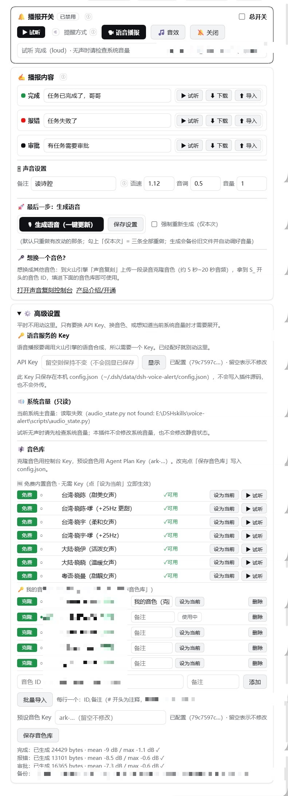
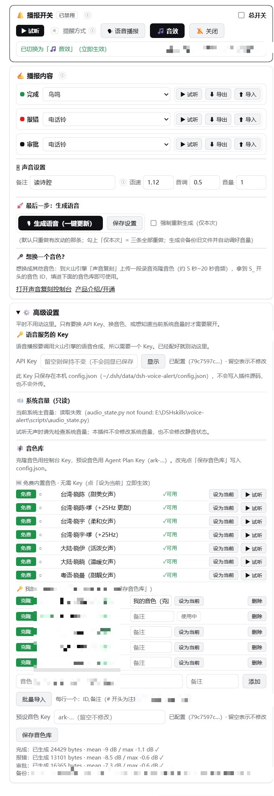

# dsh-voice-alert

DSH（DeepSeek Harness）**对话语音播报插件**：一轮对话结束自动播报「完成」语音，
出现错误 / 工具失败时播报「失败」语音。播放**绝不改动系统音量或静音状态**。

|  |  |
|---|---|

> 设置页实拍（v0.4.18，DSH 原生设置分区「语音播报」）：左 = **语音播报模式**（三条文案 + 音色库，含 7 个免费内置音色），右 = **音效模式**（每条事件一个音效下拉）。配色跟随宿主主题（浅色 / 深色都清晰），窄面板下控件自动换行不溢出。高级设置里存 Key 的输入框、克隆音色 ID 与本机路径已脱敏。

**让 DSH 干完活会开口说话** —— 装完即用，零配置：内置 **20 个音效**、三条播报文案（完成 / 失败 / 审批，
其中审批只能手动触发），
想用自己的声音再按 §4.1 一键克隆。**支持三种提醒方式**：🗣 语音播报 / 🎵 音效 / 🔕 关闭。

**v0.4.18** 修四类界面缺陷：**音色库不再重载就消失**（React 重挂载自愈）+ **音色库不再时隐时现**（槽位出生看门狗）+ **「我的音色库」终于看得见删除按钮**（任何行都可删、点完即存；删掉正在使用的音色会自动切到库里第一个）+ **试听图标的悬浮气泡永不出框**（浮出瞬间实测矩形再夹回可见区）。另更新两张脱敏效果图。v0.4.17 的两件事（界面更紧凑 + 内嵌免费音色）见下。

* **🆓 免费内置音色（详见 §4.3）**：新增第三条音色路线 `free` = 微软 **edge-tts**（不要任何 API Key）。
  音色库顶部一组「🆓 免费内置音色 · 无需 Key」共 **7 个试听音色**（台湾腔甜美女声打头），
  点「设为当前」立即生效、点「▶ 试听」当场合成并播放，**「🎙 生成语音」按钮随之直接可用**
  （旧版只看火山 Key，选了免费音色按钮永远是灰的）。
  前提：本机要有 Python 且装过 `edge-tts`，首次合成需联网 —— 缺什么界面就明说（`edge-python-missing` /
  `edge-tts-not-installed` / `edge-offline`），不会崩。产物 mp3 缓存后可离线重放。
  **这组是服务端虚拟目录**：不写进 `config.json` 的 `voices`、不混进 `/voices` 的 `list`、
  也不进 `DEFAULT_VOICES`，所以开源版「不内置任何音色」的决定与你自己的音色库**一行都没变**，
  切回自己的 Key 音色随时可行。
* **🔎 界面紧凑改造**：按用户反馈「字体太大太稀疏，往下滑不方便；最上面的下载导入没用；最好一目了然」——
  删掉「🔔 播报开关」卡顶部那排 ⬇下载 / ⬆导入 按钮（「✍️ 播报内容」每条播报本来就各带一对），
  并把 25+ 处样式压缩（卡片内边距 16/18 → 11/13、外层间距 12 → 8、标题 17 → 15px、
  正文/说明 → 11.5px、主按钮 15 → 13px 等）与 5 段长说明精简；一屏能看全的内容明显变多。

> 自检规模随版本增长：当前 v0.4.18 的 `--no-sound` 实测 **472 过 / 0 失败**（另有 6 项跳过：都会真出声，`--no-sound` 下直接不执行，不计入通过/失败）。
> 构成：§1–§16（0.4.16 及更早）共 **360 条** + §17「免费内置音色」**41 条** + §18「端到端复核缺陷回归」**21 条** + §19「第三轮复核缺陷回归」**8 条** + §20「客户端界面静态一致性」**42 条** = **472**。§18 覆盖第二轮实测报回的 6 个缺陷（D1~D6），§19 覆盖第三轮报回的 2 个缺陷（D7 `/generate` 缺畸形 free id 闸门、D8 free 名长度无上限），均已修复并有断言锁死。

**v0.4.10 / v0.4.9** 界面两处修复：
* **v0.4.9 主题自适应配色**：此前颜色**写死为深色主题色**（白字 + 亮底），
  深色背景下正常，**浅色背景下白字落在白底上＝完全看不见**。现改用宿主的
  `--dsw-alias-*` 设计令牌，随主题自动反转，两种背景都可读；并修掉两处同源问题
  （宿主 `state-success/warn` 静态色不随主题反转、在白底上对比度不足）。
* **v0.4.10 窄面板不溢出**：语速 / 音调 / 音量 一行的控件宽度被 `min-width` 锁死
  （最小 494px），面板比这窄时**第三个输入框溢出卡片右边缘**。现改为可换行 +
  解除宽度锁 + 容器可压缩。
* 这两版共新增 32 条回归断言（主题 22 + 布局 10）。

**v0.4.16** 关键修复：**三个「界面亮了但没生效」的坑**（用户实测反馈）：
* **总开关点不动** —— 复选框是受控组件却没接 `onChange`，React 立刻按旧值回写，
  表现就是「点了没反应」；而且改完还得再按一次「保存设置」。现改为**点完即存**。
* **选了「音效播报」还是响人声** —— 提醒方式按钮只改了本地高亮、**根本没发 POST**，
  宿主 `alertMode` 仍是 `voice` → 回合结束照旧合成并播放人声。现在三个按钮
  （语音 / 音效 / 关闭）统一走 `persistPatch({ alertMode })`，点完即存。
* **音量设 0 设不了** —— 三处硬编码 `0.2` 下限（前端校验 / 宿主归一化 / 输入框 `min`），
  填 0 被静默丢弃或悄悄抬回 0.2。现在**音量下限单独为 0，0 = 静音**：语音与音效一起哑，
  试听也哑，界面显示「🔕 当前音量 = 0（静音）」；语速 / 音调下限仍是 0.2。
  注意**空框 ≠ 0**：清空输入框是「不改」，不会变成静音。
* **越界值不再「假装保存成功」** —— 宿主对超范围的语速 / 音调 / 音量是**静默丢弃**的，
  旧界面无论宿主收没收都写「已保存」。现在保存后拿回包里的 `applied.prosody` 与提交值逐项比对，
  不一致就在状态行点名，例如「⚠ 未生效：音量 9（超出允许范围，已忽略）」。

**v0.4.15** 关键修复：**预设音色 Key 不会再被「留空保存」清掉**。此前在设置页点「保存音色库」时，
若「预设音色 Key」输入框是空的，会把 `config.json` 里已存好的 `presetApiKey` 覆盖成空串（无提示、无备份）。
现在三层守卫：前端留空时根本不提交该字段、宿主只在非空时写入、落盘函数同样只接受非空值
（真要清空必须显式传 `clearPresetApiKey: true`）。同时新增「已配置 / 未配置」状态回显，留空是否安全一眼可辨。

**v0.4.3** 关键修复：**默认不再做「静音预热」** —— 实测发现预热会在播报前多开关一次音频端点，
**打断蓝牙耳机上正在播放的音乐**（v0.3.5 引入的副作用）。现在 `prewarmMs: 0`（默认不预热），
需要时设回 `350` 可恢复旧行为；同时把 §5.1 的两个实战坑（**默认设备登记** / **预热副作用**）写清楚。

**v0.4.1 / v0.4.2**：waveOut 设为默认播放内核；python 解释器自动探测（跳过 WindowsApps 存根）；
自测真实播放用例之间加等待、不再叠响。

**v0.4.0** **开源准备**（可直接分发给别人，**零配置开箱即用**）：
* **默认提醒方式 = 🎵 音效**：装完即用，不需要任何 API Key、不需要任何音频文件（20 个音效随包提供）。
* **默认播放内核 = waveOut / WAV**（`playerEngine: "wav"`）：实测在蓝牙耳机下 **不吞第一声、不打断正在播的音乐**；由 ffmpeg 首次播放时自动转 WAV 并缓存（~60ms / 200~300KB）。旧内核 `"mci"`（DirectShow）保留为可选。
* **默认音色库为空**：插件不内置任何具体音色（克隆音色是各人自己的）；想用自己的声音按 §4.1 填自己的音色 ID + Key，再一键生成三条语音。
* **个人路径全部中性化**：`originalsDir` 默认在插件自己的数据目录内、`ffmpegPath` 默认走 PATH 探测、`playerScript`/`volumeProbeScript` 默认留空（只用自带播放器）。使用者无需改代码。
* 新增 `.gitignore`（排除 `__pycache__` / `config.json` / 音频产物）。发布前已核查：**无密钥、无用户名、无内网信息**。

**v0.3.9** 备选播放内核 **waveOut / WAV**（默认仍是 MCI，行为零变化，`config.playerEngine = "wav"` 一键切换）：
* 为什么：主内核 MCI `type mpegvideo` 走 DirectShow，会创建播放图并打开音频端点；在蓝牙耳机上可能触发链路重协商，**打断其他正在播放的音乐**（用户 2026-09-16 反复反馈"播报/音效后音乐显示在播但没声音"）。waveOut（`winsound`）是 Windows 最基础的播放路径：**不启 DirectShow 图、不枚举设备、不改端点格式**，对链路和其他播放器冲击最小。
* 实现：新增 `lib/play_wav_out.py`（waveOut 播放器，含 350ms 静音预热 + 毫秒级阶段日志）；host 侧新增 `ensureWavCache()` 用 ffmpeg **一次性把 mp3 转成 WAV 并缓存**（实测单文件 64ms / 236KB，源文件更新会自动重转），`playKind`/`playSfx` 在 wav 引擎下优先走它，**任何失败自动回退 MCI**，绝不因为换内核而静音。
* 实测：wav 内核 611ms 出声、总耗时 5.8s（与 MCI 的 605ms / 6.1s 相当）。
* 自测新增 12 组断言（内核解析/缓存路径/命令形状/真实转换/真实 wav 播放），全绿。

**v0.3.8** 延迟优化（用户要求：对话结束到出声更快）+ 延迟可测量：
* **预热与打开文件并行**：静音预热放进子线程，主线程同时做 MCI `open`（实测 open 只要 38ms，现在完全被预热窗口吞掉）——唤醒效果不变。
* **实测**：播放器进程启动 → 开始出声 = **610ms**（其中预热 350ms + 链路稳定等待 150ms 是"第一次就有声"的代价）；加上 powershell/python 启动（约 200~400ms），**对话结束到听见声音约 0.8~1.0 秒**。触发本身仍是 **1ms 内**（`play launched` 与 `turn-end` 同毫秒）。
* **毫秒级阶段日志**：日志变成 `[时间.毫秒] sfx-player: +610ms play issued rc=0`，以后任何延迟疑问都能直接对着日志算，不用再猜。自测新增两条断言锁住「进程启动→出声 <900ms」和「open 发生在预热窗口内」。

**v0.3.7** 「**强制重新生成**」改成**一次性**（用户 2026-09-16 确认）：勾上后**本次**把三条语音全部重新合成（真实调用 TTS），提交成功后**自动取消勾选**；提交失败则保留勾选便于直接重试。标签改为「强制重新生成（仅本次）」并加了说明气泡。原来的坑：勾选框不会复位，勾一次后每次生成都强制重做三条、白耗额度。
* 顺带明确语义：不勾时插件比对每条语音的「指纹」（文案 + 音色 ID + 语速 + 音调 + 音量）——**全都没变就复用现有 mp3、完全不调用 TTS**；哪条变了只重做那一条；文件缺失也会自动重做。

**v0.3.6** 把「没声音怎么办」写进界面：总控卡「▶ 试听一下」正下方新增**常驻提示**（`dva-audio-tip`）——「点了试听没声音？把系统音量拖一下再点一次就有声了 —— 蓝牙耳机 / 虚拟声卡空闲挂起时，系统会把第一次播放吞掉，调音量正好把它唤醒」。

**v0.3.5** 修「**刚生成语音后点试听没声音，调一下系统音量就有声音**」（用户实测报告，根因探针实测非推测）：
* **实测证据**：MCI `open`/`play` 返回码全 0、`status position` 正常推进（229→482→733→983 ms）、`mode=playing`、系统音量 35% 非静音——音频确实在"播放"；而同一时刻 Core Audio 探针（`IMMDeviceEnumerator`）读出**默认输出设备 = 耳机 (EDIFIER Lolli Pro 5)，即蓝牙耳机**（三个 role 一致）。蓝牙 A2DP 链路空闲后会挂起，这段时间 Windows 仍把音频"成功"送进驱动、**耳机端不出声**；**调节系统音量会立刻激活链路**——这正是"调一下音量之后就有声音"的来源。虚拟声卡端点未唤醒时同理。
* **修复**：播放前先用 **350 ms 静音预热默认端点**（同步等待链路建立），再播真实音频；预热只播静音，**不读写任何音量 / 静音接口**（硬规则不变）。
* **顺带修一处旧缺陷**：MCI `play` 的返回码此前被完全忽略，播放失败会被当成"播完了"（静默误报成功）。现在检查返回码，失败重试一次。
* **诊断留痕**：播放全程写进插件日志（`--log-file`），含 `prewarm ok` / `play_rc` / `positions` —— 以后遇到无声可查 `<data>\voice-alert.log` 直接判断是"没播起来"还是"播了但端点没出声"。
* 若仍偶发无声：多半是蓝牙耳机 / 虚拟声卡的省电策略所致，可在「设备管理器 → 蓝牙适配器 → 电源管理」取消勾选"允许计算机关闭此设备以节约电源"，或改用有线耳机。

**v0.3.4** 依用户反馈再修（**界面不再出现任何具体人名**，插件可直接分发给别人用）：
* 音色名一律由使用者在「音色备注」里自己填（默认留空）；界面只叫「**🎙 我的音色 · 语音合成**」。
* **音效改成可勾选列表**：20 个音效各占一行，行内三个勾选框（完成/失败/审批，同事件互斥）+ 音效名 + 「▶ 试听」。列表由 React 直接渲染，根治 v0.3.3「选了没反应」（下拉 option 被重渲染清空）。**（此处为 v0.3.4 当时的形态；v0.4.17 第十三/十四轮已改成「每条事件一个下拉」，现状见 §4.2。）**
* **一键生成 + 明确反馈**：点「🎙 生成语音（一键更新）」会**先自动保存文案再合成**；运行中显示 `x/y` 进度，结束后明确显示「**✅ 语音更新成功！已重新合成 N 条，复用 M 条**」，失败显示「⚠️ 语音更新失败：… 合成出错」。
* **克隆入口写进界面**：新增「克隆音色」行 + 两个链接——[声音复刻控制台](https://console.volcengine.com/speech/app)、[产品介绍/开通](https://www.volcengine.com/product/voicecloning)。
* **修复「有时点试听没声音」**：所有播放入口（引擎播报 / `/preview` / `/sfx/play`）**串行化**——等上一个播完再开下一个，避免两个 python+MCI 进程抢声卡导致后一个静默失败。

**v0.3.3** 新增**音效提醒**：内置 **20 个音效**（提醒 10：叮咚/电话铃/消息提示/闹钟/滴滴/清脆叮/钟声/成功号角/欢快音/木鱼；大自然 10：鸟鸣/蝉鸣/蛙鸣/雨声/海浪/溪流/风声/篝火/雷鸣/森林），设置页一个全局「提醒方式」三选：**🗣 语音播报 / 🎵 音效 / 🔕 关闭**。音效模式**完全不调用 TTS、不需要 API Key**；选音效时展开「完成 / 失败 / 审批」三个勾选（默认 成功号角 / 木鱼 / 叮咚），每行可一键试听。详见 §4.2。

> v0.3.3 同版修正：**「🎙 我的音色 · 语音合成」卡常驻页面**（不再藏进折叠区）——三条播报文案 + 试听 + **一键生成主按钮**一目了然。

**v0.3.2** 设置页 UI 傻瓜化重做（`lib/client.js`）：中文优先字体（微软雅黑，标题 16px/正文 14px/行距 1.6）、卡片式分区（语音播报总控大卡 → 常用设置卡 → 「高级设置」折叠卡，默认收起）、主次分明的按钮布局（「▶ 试听一下」大按钮 + 强调色主按钮，hover/active 反馈）；高级项（文案/API Key/音色库/系统音量/日志）收进折叠面板，折叠只影响可见性、DOM 元素全部保留。

**v0.3.1** 在 DSH 原生设置页新增**音色库**能力（`lib/client.js` 渲染的「语音播报」分区，见 §4.1：克隆/预设双路由、批量导入、试合验证；v0.3.1 已移除 v0.3.0 的朗读面板）。

A DSH plugin that deterministically plays a fixed voice alert when a conversation turn finishes and a
different one when something failed, plus a settings-section voice library.

---

## 功能总览 · At a glance（中英对照 / Bilingual）

### 播报事件 · Alert events

| 中文 | English |
|---|---|
| 每个 turn 结束自动播报「完成」语音 | Plays a "done" voice when any conversation turn ends |
| turn 内出现错误（`agent/error` 或工具 `isError`）播报「失败」 | Plays a "fail" voice when the turn had errors (`agent/error` or tool `isError`) |
| 同 turn 只播一次（去重）、错误优先（不叠加完成）、错误播报节流（默认 5s） | Per-turn dedup, error-first (never stacks "done"), error throttling (5s default) |
| 「失败」后 3s 内抑制「完成」防连声，可关闭 | Suppresses "done" for 3s after a "fail" — no back-to-back sounds; disable with 0 |
| 用户中断（aborted）默认不播；子代理会话默认跳过，均可配置 | User aborts silent by default; subagent sessions skipped — both configurable |

### 三种提醒方式 · Three alert modes

| 中文 | English |
|---|---|
| 🗣 语音：用**当前选中音色**朗读文案 —— 可选 §4.3 的免费内置音色（零 Key）、自己的克隆音色或预设音色（自动播报只有**完成 / 失败**两种，详见下方说明） | 🗣 Voice: the selected voice reads your lines — a free built-in voice (§4.3, no key at all), or your own clone / preset voice (only **done / fail** fire automatically — see note below) |
| 🎵 音效：内置 20 个音效（提醒 10 + 大自然 10），零配置、无需 API Key 开箱即用 | 🎵 SFX: 20 built-in sounds (10 alerts + 10 nature), zero config, no API key needed |
| 🔕 关闭：完成/失败/审批都不提醒 | 🔕 Off: no alerts at all |
| 每条事件（完成/失败/审批）各有一个下拉选音效，选中即生效，旁边带「▶ 试听 / ⬇ 导出 / ⬆ 导入」 | Each event (done/fail/approval) has its own dropdown; picking one applies immediately, with "▶ preview / ⬇ export / ⬆ import" next to it |

> **⚠️ 关于「审批」事件**：插件只监听了三个 DSH 事件 —— `session/event`（turn 结束 → 完成）、
> `agent/error`（→ 失败）、`tools/result`。**审批没有自动触发源**，`engine.js` 里也没有任何
> 权限/审批事件监听。`approval` 只能手动触发：`GET /dsh-voice-alert/play?kind=approval`、
> `GET /dsh-voice-alert/preview?kind=approval`，或在控制文件里写 `kind=approval`。
> 换成一句话：**自动播报 = 完成 / 失败；审批是手动播放的第三个音效槽位**。

### 音色库 · Voice library

| 中文 | English |
|---|---|
| **🆓 免费内置音色（v0.4.17）**：第三条路线 `free` = 微软 edge-tts，**零 API Key**，7 个试听音色（台湾腔甜美女声打头），点「设为当前」立即生效、「▶ 试听」当场合成 | **🆓 Free built-in voices (v0.4.17)**: a third route `free` = Microsoft edge-tts, **no API key at all**, 7 audition voices (Taiwan-accent sweet female first), "set current" applies instantly, "▶ audition" synthesises on the spot |
| 免费音色是服务端虚拟目录：不进 `config.json` 的 `voices`、不混进 `/voices` 列表、不进 `DEFAULT_VOICES`，绝不影响你自己的 Key 音色 | The free set is a server-side virtual catalogue: never written into `config.json` `voices`, never merged into the `/voices` list, not in `DEFAULT_VOICES` — your own key voices stay untouched |
| 火山克隆音色 / 预设音色双路由（`seed-icl-2.0` / `seed-tts-2.0`），自动识别类型 | Clone & preset TTS routing (`seed-icl-2.0` / `seed-tts-2.0`), type auto-detected |
| 批量导入（多行 `ID,备注` 或 JSON）、自动去重；`POST /voices/probe` 可逐条试合验证（界面不再放「试合」按钮，免费音色同样自动分流到 edge 合成） | Batch import (`ID,note` lines or JSON) with dedup; `POST /voices/probe` verifies one voice with a real trial synthesis (no "probe" button in the UI; free voices route to edge synthesis) |
| 生成指纹复用：文案/音色/语速/音调/音量没变就复用既有 mp3，零 TTS 消耗 | Fingerprint reuse: unchanged text/voice/params reuse existing mp3s, zero TTS calls |
| 默认音色库为空，音色名由使用者自填——不含任何具体人名 | Empty default voice library, names filled in by the user — no personal data shipped |

### 播放与兼容 · Playback & compatibility

| 中文 | English |
|---|---|
| 默认 waveOut/WAV 播放内核（不吞第一声、不打断蓝牙音乐），MCI 可选，失败自动回退 | waveOut/WAV player by default (no lost first sound, doesn't cut Bluetooth music), MCI optional, auto-fallback |
| 绝不改动系统音量或静音状态（winmm 原样播放） | Never touches system volume or mute state (winmm plays as-is) |
| 播放进程经隐藏 PowerShell → Start-Process 独立拉起，DSH 会话销毁杀不到声音 | Player spawned detached via hidden PowerShell → Start-Process, immune to session teardown |
| 播放失败全线静默降级（缺文件→蜂鸣、异常→仅日志），绝不影响 DSH 运行 | Silent fallback everywhere (missing file → beep, exceptions → log only), never affects DSH |
| 蓝牙耳机专项适配：默认不预热（`prewarmMs: 0`）不再打断音乐，实测文档齐全 | Bluetooth headset tuning: prewarm off by default (no music cuts), documented with measurements |

### 音频导出 / 导入 · MP3 export & import

| 中文 | English |
|---|---|
| 试听旁一键**下载 mp3**（每条播报独立下载，可选增益版/原件） | One-click **download** next to every preview (per-kind, gain or original) |
| 试听旁一键**导入 mp3**（用你自己的音频替换某条播报，导入后自动试听一次） | One-click **import** next to every preview (replace any kind with your own audio, auto-previewed once) |
| 导入前自动备份旧文件、同时写 origin 与 loud 两份、清掉过期 wav 缓存 | Auto-backup before overwrite, writes both origin and loud copies, drops the stale wav cache |
| 导入限 10 MB，前后端双重校验，非 mp3 直接拒绝（不会误覆盖语音文件） | 10 MB cap enforced on both sides; non-mp3 rejected so voice files are never clobbered |
| **导入的 mp3 不会被「生成语音」冲掉**：改别的文案时该条自动跳过合成（P0 修复） | **An imported mp3 survives later synthesis runs**: the kind is skipped while a text edit regenerates the others (P0 fix) |
| 每行显示「已导入」状态，可一键**撤销导入**回到自动生成的语音 | Each row shows its imported state and offers one-click **undo** back to the synthesised clip |
| 后台错误原因翻成中文人话（不是把 `not an mp3` 甩给用户） | Host error reasons are translated into plain Chinese instead of raw English |

### 界面与诊断 · UI & diagnostics

| 中文 | English |
|---|---|
| DSH 原生设置页「语音播报」分区：总控卡 + 常用设置 + 高级折叠，中文优先字体 | Native DSH settings section "语音播报": master card + common settings + collapsible advanced, CJK-first typography |
| **紧凑排版（v0.4.17）**：卡片内边距 16/18 → 11/13px、外层间距 12 → 8px、卡标题 17 → 15px、正文/说明 → 11.5px、分节标题/输入框/次按钮 → 12.5px、主按钮 15 → 13px、行内动作按钮/音效行 → 11.5px；并删掉「🔔 播报开关」卡顶部多余的 ⬇下载 / ⬆导入 一排（每条播报本来就各带一对） | **Compact layout (v0.4.17)**: card padding 16/18 → 11/13px, outer gap 12 → 8px, card title 17 → 15px, body/desc → 11.5px, section titles/inputs/secondary buttons → 12.5px, primary button 15 → 13px, row action buttons & sfx rows → 11.5px; plus the redundant ⬇download / ⬆import strip on the master card removed (each cue row already carries its own pair) |
| **说明文字一律悬浮展示（v0.4.17）**：常驻段落收进 ⓘ / 🔈 图标后的气泡，悬停（或键盘聚焦）才显示，平时不占版面；音色库每行还改成「一行放下」——行容器不换行、文本列可收缩到省略号、按钮不缩不折，窄面板下按钮不再被挤出卡片 | **Hover tooltips everywhere (v0.4.17)**: standing paragraphs moved into bubbles behind ⓘ / 🔈 icons, shown on hover (or keyboard focus) and taking no room otherwise; voice-library rows now stay on one line — no wrap, shrinkable text columns, non-shrinking buttons, so buttons no longer get pushed off the card on narrow panels |
| 毫秒级阶段日志（`<data>\voice-alert.log`），任何延迟/无声可对着日志定位 | Millisecond stage logs (voice-alert.log) to pinpoint latency or silence |
| 免凭据控制通道：写 `control.txt` 即触发真播，`status.json` 快照验收 | Credential-free control: write `control.txt` to trigger a real play, read `status.json` to verify |
| **配色跟随宿主主题**：浅色/深色背景下都清晰（走 `--dsw-alias-*` 设计令牌，不写死色值） | **Theme-aware colors**: legible on both light and dark backgrounds (host design tokens, no hard-coded colors) |
| **472 项自测断言**（`--no-sound` 实测 472 过 / 0 失败，另有 6 项跳过：都会真出声；构成 = §1–§16 共 360 条 + §17 41 条 + §18 21 条 + §19 8 条 + §20 42 条），HTTP 路由仅回环 | 472 self-check assertions (`--no-sound`: 472 pass / 0 fail; 6 skipped — all would really play audio; 360 in §1–§16 + 41 in §17 + 21 in §18 + 8 in §19 + 42 in §20); HTTP routes loopback-only |

---

## 1. 它做什么

| 事件 | 语音 | 文件（默认优先播放增益版） |
|---|---|---|
| 任意一个 **turn 结束** | 完成 | `voice-alert-complete-poetic-loud.mp3` |
| 该 turn 内出现过错误（`agent/error` 或工具 `isError`） | 失败 | `voice-alert-fail-poetic-loud.mp3` |
| 立即错误播报（工具失败/agent 报错当下，节流 5s） | 失败 | 同上 |
| 手动验证（HTTP 路由）**仅手动** | 完成/失败/审批 | `voice-alert-approval-poetic-loud.mp3` |

> **自动播报只有「完成 / 失败」两种。** 上表最后一行是手动触发的验证入口（`/play?kind=approval`），
> 不是自动事件 —— 插件没有监听任何权限/审批类 DSH 事件。详见 §3 末尾的说明。

音频**永不改动系统音量与静音状态**：播放器用 winmm/MCI「原样播放」（系统多大就多大，系统静音就无声），
不读写任何音频控制接口。响度问题通过**音频文件本身**解决（见 §4）。

---

## 2. 事件依据（官方源码实证，非猜测）

| 用途 | 事件 | 出处（已装官方包） |
|---|---|---|
| 判「一个 turn 结束」 | `session/event` 且 `event.type === "turn/end"` | `@deepseek-ai/dsh-agent-loop/lib/index.js:994`（`finally` 里 append `turn/end`） |
| 识别 turn 开始（用于归属错误） | `session/event` 且 `event.type === "turn/start"` | 同上 `:926` |
| 判「出现错误」 | `agent/error`，payload `{agent, turn, step, error}` | 同上 `:863`（`throwError`），且在 `turn/end` **之前**发出（`:991` → `:994`） |
| 判「工具失败」 | `tools/result` 的 `result.isError` | `@deepseek-ai/dsh-tools/lib/types/index.js:3287`（以 `exec.agent` 为 scope 派发） |

关键结论：

* `turn/end` **每个 turn 只发一次**（不是每个 step），所以含大量工具调用的长任务只会按 turn 播报；含工具的一轮会话不会因为 step 多而重复播报。
* `agent/status`（running→idle）只在「整个 agent 彻底空闲」时变化，**不是**每 turn 信号，因此没有采用。
* `session/event` 的**历史回放不发事件**（构造函数种子不 emit，见 `dsh-session/lib/index.js` 注释），所以 DSH 重启 / 恢复会话不会误报。

---

## 3. 去重与错误优先（实现要点）

* **同一 turn 只播一次**：以 `sessionId#turn` 为键登记，重复的 `turn/end` 直接忽略（缓存上限由 `dedupeCacheSize` 控制）。
* **错误优先**：`turn/start` 打开该会话的 turn 记录；该 turn 内出现 `agent/error` 或 `tools/result.isError` 即把该 turn 标记为 errored；
  `turn/end` 时若已 errored → 只播**失败**，不叠加播完成。
* **错误节流**：立即失败播报受 `errorMinIntervalMs`（默认 5000ms）约束，同一时间窗内只播一次。
* **断「失败+完成」连声**（2026-09-15 新增）：任意 fail 语音播出后 `suppressCompleteAfterFailMs`（默认 3000ms）之内，
  `turn/end` 的 **complete 一律抑制并记日志**（`suppressedComplete` 计数）。两个开关彼此独立：`errorMinIntervalMs` 管 fail 自身节流，
  `suppressCompleteAfterFailMs` 只管「fail 之后是否还允许立刻播 complete」；设 `0` 关闭本闸门。
  实测场景（宿主日志 2026-09-15 11:28:23）：`agent/error` 播 fail 后 0.26s，同 turn 的 `turn/end` 又播 complete → 本闸门消除。
* **turn/end 的 reason 映射**：`completed` / `max-tokens` → 完成；`error` / `blocked` → 失败；`aborted`（用户中断）默认**不播**（`abortPlays: none|complete|fail`）。
* **子代理会话默认不播**：按会话 header 的 `origin === "subagent"` / `delegationDepth > 0` 判定（`skipSubagentSessions`，默认 true），
  避免一个长任务里子代理每轮都播；需要时设 `countSubagentErrors: true` 让子代理错误也计入父会话。

---

## 4. 响度（"声音太小"的根因与解法）

真因：**系统主音量只有 9.0%**（未静音）。用户明确选择**不调整系统音量**（2026-08-26 铁律），
因此只从音频文件侧解决。原始 poetic MP3 实测（ffmpeg volumedetect）：

| 文件 | 原始 mean_volume | 原始 max_volume | 增益版 mean | 增益版 max | 提升 |
|---|---|---|---|---|---|
| voice-alert-complete-poetic.mp3 | −20.8 dB | −7.0 dB | −8.7 dB | −0.6 dB | +12.1 dB |
| voice-alert-fail-poetic.mp3 | −20.9 dB | −5.1 dB | −8.7 dB | −0.5 dB | +12.2 dB |
| voice-alert-approval-poetic.mp3 | −19.9 dB | −5.3 dB | −8.8 dB | 0.0 dB | +11.1 dB |

* 处理链：`volume=+26dB,alimiter=limit=0.95:level=disabled`（限幅器把峰值压在 0.95≈−0.45 dBFS 之下，不削波）。
* 生成方式：本地 ffmpeg 一键增益（该脚本是本机开发脚本，含本机绝对路径，**不随开源包发布**），输出到 `<home>\.dsh\data\dsh-voice-alert\audio\voice-alert-<kind>-poetic-loud.mp3`。
* **原始 MP3 一律不改动**，插件播放优先级：**增益版 → 原始版 → 蜂鸣降级**。
* 增益版与原始版都用插件自带的 `lib/play_mp3_mci.py` 播放（`--file`，winmm/MCI「原样播放」机制）。
  仅当你自己在 `config.json` 里配了 `playerScript`（可选的共享播放器）时，原始版才改走它的 `--kind` 入口。
  两者都**不读写任何音频控制接口**：系统音量多大就多大，系统静音就无声。
* 关闭增益版：`config.json` 里 `"preferLoudAudio": false`。
* **增益是「尽力而为」，缺 ffmpeg 不算失败**：本机没装 ffmpeg（且 `ffmpegPath` 也没指到可用二进制）时，
  插件把原始文件**直接复制**到增益版路径，合成结果里带 `gainSkipped: true` 与原因，`ok` 仍为 `true`、
  该条提醒照常可播（只是音量没被抬高）。设置页的「音频状态」会显示这一情况，不会把它当成错误。
  所以「自检里转换用例失败」与「插件不能用」是两件事 —— 前者只是这台机器缺 ffmpeg。
* **ffmpeg 探测结果带缓存（v0.4.17 缺陷修复 D6）**：`resolveFfmpeg()` 以前每次调用都 `spawnSync("ffmpeg","-version")`，
  而设置页一打开就要问一次（`GET /settings` 返回里的 `gain.ffmpeg`）—— 没装 ffmpeg 的机器每次开面板都得阻塞探一遍。
  现在**探测成功的结果永久缓存**，**失败的结果只缓 60 s**（所以中途装上 ffmpeg 不用重启就能自愈）；
  需要强制重探的调用（自检）走 `noCache` 逃生口。顺带也减少了打开面板时的子进程开销与加载时间。

---

## 4.1 音色库（需求 A · v0.3.0）

设置页「语音播报」分区新增**音色库**小节，管理三类 TTS 音色：

| 类型 | 端点 | Resource | Key | 判定 |
|---|---|---|---|---|
| 克隆（`clone`） | `/api/v3/tts/unidirectional` | `seed-icl-2.0` | 控制台 Key（`tts.apiKey`） | ID 以 `S_` 开头 |
| 预设（`preset`） | `/api/v3/plan/tts/unidirectional` | `seed-tts-2.0` | Agent Plan Key（`presetApiKey`，`ark-…`） | ID 以 `zh_`/`BV` 等开头 |
| **免费内置（`free`，v0.4.17）** | 无 HTTP 端点（本机 edge-tts 子进程，走微软 Edge 朗读） | 无 | **不需要任何 Key** | ID 以 `free:` 开头（见 §4.3） |

* 每行显示：类型徽标、当前圆点、音色 ID、可用性（✓可用 / 缺 key）、备注（可编辑）、「设为当前」、「删除」。免费音色那一组另有「▶ 试听」。
* **试合（仅 API，界面无按钮）**：`POST /voices/probe` 用约 20 字短文本真实调用一次 TTS（不写入任何文件），成功返回 `{ok:true, bytes}`，失败返回火山错误码/信息。v0.4.18 起界面上不再放「试合」按钮（用户要求音色库少按钮）。
* **批量导入**：粘贴多行 `ID,备注`（`#` 为注释）或 JSON 数组，自动识别类型、自动去重，幂等可反复导入。
* **删除**（v0.4.18）：**任何一行都可删**，点完立刻写盘（不用再点保存）；删掉的正是「正在使用」的音色时，宿主会自动把 `selectedVoiceId` 切到库里第一个可用音色，不会留下悬空选择。备注等其它改动仍走下方「保存音色库」整体写回 `config.json`，手工添加的音色重启不丢。
* **生成侧按 kind 路由**：合成前按音色类型选 endpoint/resource/key/speaker，混用必 401/403 的坑已被显式拒绝——预设音色被选但 `presetApiKey` 未配置时，返回明确错误 `preset-key-missing`，绝不静默用错 Key。`free` 则**完全不发 HTTP**，分流到本机 edge-tts 子进程（v0.4.17）。
* 生成接口（`POST /generate`）支持 `speakerId` 参数，缺省用当前选中音色；音色切换会改变生成指纹，自动触发重合成。
* 预设音色 Key 入口：音色库小节底部「预设音色 Key」输入框（`ark-…`，留空不修改），随「保存音色库」写入 `config.json` 的 `presetApiKey`。**留空 = 保持原值不动**（v0.4.15 三层守卫：前端不提交空字段、宿主只写非空、落盘只收非空；要清空必须显式传 `clearPresetApiKey: true`）。输入框下方实时显示「已配置（mask）/ 未配置」状态。

**默认音色库为空**（v0.4.0 开源决定）：插件不代你选**你自己的**音色。克隆音色到火山「声音复刻」做（拿到 `S_` 开头的 ID），
预设音色需要自己的 Agent Plan Key（`ark-…`）。两者都在设置页「音色库」里添加或批量导入，只存本机 `config.json`。
（v0.4.17 起页面上另有一组**不入库**的免费音色可直接用，见 §4.3 —— 它没有改变上面这条决定。）

---

## 4.2 音效提醒（需求 B · v0.3.3）

不想折腾火山音色 / 不需要 API Key 时，把「提醒方式」切到 **🎵 音效** 即可：turn 结束就播一个内置音效。
（想听到**人声**又不想配 Key，v0.4.17 起还有第三条路：§4.3 的免费内置音色。）

**内置 20 个音效**（`<data>\sfx\*.mp3`，单声道 44.1 kHz / libmp3lame 128k，已做响度统一）：

| 分组 | 音效 |
|---|---|
| 提醒（10） | 叮咚 / 电话铃 / 消息提示 / 闹钟 / 滴滴 / 清脆叮 / 钟声 / 成功号角 / 欢快音 / 木鱼 |
| 大自然（10） | 鸟鸣 / 蝉鸣 / 蛙鸣 / 雨声 / 海浪 / 溪流 / 风声 / 篝火 / 雷鸣 / 森林 |

* **默认分配**：完成 → 成功号角，失败 → 木鱼，审批 → 叮咚（`sfxByKind`，可逐个更换）。审批槽位只在手动触发时用到（`/play?kind=approval` 或控制文件），不会自动响。
* **选择方式**（v0.4.17 第十三 / 十四轮改版）：**每条事件一行**（完成 / 失败 / 审批），中段是一个**下拉框**（`dva-sfxselect-<kind>`，20 个音效按「🔔 提醒音 / 🌿 大自然」分组），选中即生效并落盘；同一位置旁边是「▶ 试听 / ⬇ 导出 / ⬆ 导入」。语音模式与音效模式**预渲染两套同构行**（`dva-row-voice-<kind>` / `dva-row-sfx-<kind>`），切模式只翻 `display`、零 React 重渲染，界面即时切换。
* **试听**：「▶ 试听」走 `GET /sfx/play?name=<key>`，**不经过引擎**，绝不会影响完成/失败的判定；v0.3.4 起试听会**排队**（等上一个播完），连点不再出现"没声音"。
* **完整性**：`GET /sfx/list` 返回目录 + 每个文件是否在库（`present`）。v0.4.17 起界面**不再**显示「共 20 个内置音效，已在库 N 个」这行文字（用户要求精简，第十七轮删除）。
* **导出 / 导入**（v0.4.17 恢复）：每条事件旁「⬇ 导出」走 `GET /sfx/download?name=<key>`，「⬆ 导入」走 `POST /sfx/import?name=<key>`（body = 原始 mp3 字节）；导入前自动备份旧音效并清掉该音效的 wav 缓存。
* **来源**：提醒 10 个来自 Windows 系统音效（转 mp3）+ 1 个合成木鱼音；大自然 10 个来自 pacdv.com / mixkit.co 免费音效库。全部随插件本机存放，无外链。
* **安全**：播放文件名只接受 `[a-z0-9-]` 的目录 key（`sfxPathFor` 再校验一次），`/sfx/play?name=../../x` 直接 400；音效同样走 scratch copy，不会被播放占用。

### 提醒方式三种取值

| `alertMode` | 行为 | 需要 API Key |
|---|---|---|
| `sfx`（默认） | 播内置音效，**完全不调用 TTS**，装完即用 | 不需要 |
| `voice` | 播报三条文案的语音，用**当前选中音色**：选 §4.3 的免费音色**不需要任何 Key**；选自己的克隆/预设音色才需要配 Key | 免费音色不需要 / 火山音色需要 |
| `off` | 完成 / 失败都不提醒（审批本来就不会自动播放） | 不需要 |

> `enabled`（总开关）优先级最高：关掉后三种模式一律静音（引擎层拦截，勾选即存、立即生效）。

---

## 4.3 免费内置音色（v0.4.17 · edge-tts，零 Key）

用户需求（2026-10-24）：**「内嵌有没有免费得不需要 api 得字生语音，安装上直接体验语音提醒」**，
音色偏好「甜美得女生声音台湾腔」。此前语音模式**必须**先有火山 Key 才能出声，新装的用户只能听音效。

### 它是什么

第三条音色路线 `kind: "free"`，用 **edge-tts**（pip 上的 MIT 开源包）调用微软 Edge「大声朗读」的公开端点：
**零凭据、零 Key**。新增模块 `lib/edgevoice.js` 负责合成，返回结构与火山 `synthesize()` 完全一致
（`{ok, bytes, error?, reason?, kind}`，且**永不抛异常**），所以调用方只多一个 `kind === "free"` 分支。

### 7 个试听音色（`FREE_VOICES`，`lib/config.js`）

| id | 界面标签 | edge 音色 | pitch | rate |
|---|---|---|---|---|
| `free:tw-chen` | 台湾·晓陈（甜美女声） | `zh-TW-HsiaoChenNeural` | `+0Hz` | `+0%` |
| `free:tw-chen-cute` | 台湾·晓陈·嗲（+25Hz 更甜） | `zh-TW-HsiaoChenNeural` | `+25Hz` | `+8%` |
| `free:tw-yu` | 台湾·晓宇（柔和女声） | `zh-TW-HsiaoYuNeural` | `+0Hz` | `+0%` |
| `free:tw-yu-cute` | 台湾·晓宇·嗲（+25Hz） | `zh-TW-HsiaoYuNeural` | `+25Hz` | `+8%` |
| `free:cn-xiaoyi` | 大陆·晓伊（活泼女声） | `zh-CN-XiaoyiNeural` | `+0Hz` | `+0%` |
| `free:cn-xiaoxiao` | 大陆·晓晓（温暖女声） | `zh-CN-XiaoxiaoNeural` | `+0Hz` | `+0%` |
| `free:hk-hiumaan` | 粤语·晓曼（甜靓女声） | `zh-HK-HiuMaanNeural` | `+0Hz` | `+0%` |

* `pitch` / `rate` 是 2026-10 用同一句文案**实测调校**出来的值（+25Hz / +8% 就是当时用户验收过的「嗲版」），
  不是拍脑袋，改之前先重听。目录里没有「推荐」标记，`free:tw-chen` 只是**排在第一位**（台湾腔甜美女声）。
* 熟练用户还可手写内联形式 `free:zh-TW-HsiaoChenNeural`（`isFreeVoiceId` 认这种形状），
  此时标签显示「自定义 edge 音色（…）」，pitch/rate 用默认 `+0Hz` / `+0%`。
  **名字部分上限 60 字符**（`FREE_VOICE_NAME_MAX`）；超长的既不算合法 free id，也不能白名单放行 ——
  否则试听缓存文件名会超过 MAX_PATH、写盘失败被静默吞掉，变成每次试听都重新联网合成（见 §8 的 D8）。

### 依赖前提（实话）

免费 ≠ 无成本。要真的出声，需要：

1. **本机有可用的 Python**（走 `resolvePython()`，会跳过 Windows「应用执行别名」那个假 `python` 存根）；
2. **装过 edge-tts**：`pip install edge-tts`（国内建议 `pip install edge-tts -i https://mirrors.aliyun.com/pypi/simple/`）；
3. **首次合成要联网**（edge-tts 是在线服务）。产物 mp3 落盘后就走普通音频链路，**之后可离线重放**。

三者缺一，界面**明确告诉你缺哪个**，不会崩：音色库「🆓 免费内置音色」分组下方按检测结果直接给提示行
（找不到 Python → 「⚠ 找不到可用的 Python：免费音色需要 Python + edge-tts…」；
有 Python 但缺模块 → 「⚠ 本机已装 Python，但缺 edge-tts 模块：在终端执行 `pip install edge-tts` 后即可试听」），
每条的可用性列显示 `✓可用` / `缺edge-tts`；试听失败时 reason 原样回显
（`edge-python-missing` / `edge-tts-not-installed`（并附「装一下：pip install edge-tts」）/
`edge-offline` / `edge-timeout` = 网络不通或超时）。检测结果由 `GET /free/runtime` 提供，
**只查本机 python 与 `edge_tts` 能否 import，不测网络**，并带结果缓存 —— 但**正负分档**：
检测通过缓存 30 s（免得每次开设置页都 spawn 一个进程），**检测失败只缓存 5 s**，
这样用户照着提示 `pip install edge-tts` 装完，刷新页面立刻就能看到 `✓可用`，不会还顶着「缺 edge-tts」。
另外，**试听一旦成功**，前端会就地把自己的检测结果改写成「python + edge-tts 都在」并立刻重画徽标 ——
省掉一次刷新，也免得 30 s 缓存里还挂着旧结论。
落盘的文件名一律先把音色 id 里的非法字符（**包括冒号**）洗成 `_`：`free:tw-chen` 里的冒号在 NTFS 上是
**交替数据流（ADS）分隔符**，不洗的话删临时文件只会删掉那条流、宿主文件留在原地，每合成一次漏一个 0 字节垃圾文件。

### 为什么它不影响你自己的音色库（关键设计）

`FREE_VOICES` 是**服务端虚拟目录**，代码里有三条硬约束：

* **不写进 `DEFAULT_VOICES`**（它仍是 `[]`）—— 开源版「不内置任何音色」的决定原样保留；
* **不混进 `/voices` 的 `list`**：以**独立字段 `freeVoices`** 返回，`list` 里永远只有你自己的 key 音色；
* **不落盘**：唯一闸门是 `config.js` 的 `isVoicesLibraryId(id)`（= `!isFreeVoiceId(id)`），`normalizeVoices` 与 `mergeVoiceImport` **都问它**，所以无论是 7 条目录 id 还是手写的 `free:zh-CN-XiaoxiaoNeural`，一律进不了 `config.json` 的 `voices`。此前判据分散在保存路径（只比 7 条目录 id）、导入路径与客户端前缀过滤，各写一套、互相打架 —— 手写 free 能落盘、又被客户端在下次保存时删掉；现在收成一个函数，不可能再自相矛盾。`/voices/save` 里的 `selectedVoiceId` 也**必须校验**（库里存在 / 合法 free id / 空串三者之一）才写入，乱粘一个串会被记进日志并忽略，不会让后续每次合成都报一个看不懂的 Key 错误。

唯一持久化的新东西是 `selectedVoiceId` 可以指向一个 `free:` id ——
`resolveConfig()` 专门为此开了口子（不因「不在库里」被顶回第一个音色），
换回自己的 `S_`/preset 音色随时可行，两边互不干扰。

### 界面与路由

* 音色库分两组渲染：**「🆓 免费内置音色 · 无需 Key（点「设为当前」立即生效）」** 与
  **「🔑 我的音色库 · 需要 Key（改完点下方「保存音色库」）」**（后者同时容纳克隆与预设两类）。
  每条免费音色一行：`免费` 徽标 + 当前选中圆点 + 标签（悬停显示 edge 音色/pitch/rate）+ 可用性
  （`✓可用` / `缺edge-tts`）+ **「设为当前」+「▶ 试听」**。点「设为当前」只提交 `selectedVoiceId`，**立即生效、不用再点保存**。
* 选了免费音色后，**「🎙 生成语音」按钮立刻可用**（`currentVoiceReady()` 对 `free:` 直接返回 true），
  不再误显示「未配置 TTS API Key」——这正是免费音色存在的意义。
* 音色库每行按「一行放下」排版（v0.4.17）：行不换行、标签/备注列可收缩、按钮不缩不折，窄面板下也不会把按钮挤出卡片（§20l2 已把它钉成自检断言，光查字面量测不到复发）。「声音设置」卡的音色备注行同理：那句说明改走 ⓘ 悬浮气泡、备注框吃掉行的剩余宽度，窄面板下不再折成第二行（§20m / §20n 锁死）。
* **悬浮气泡永不出框**（v0.4.18，用户实测报回「试听的展开消息显示不完整出框了」）：气泡是 `position:absolute` 挂在 ⓘ / 🔈 上，
  纯 CSS 既不知道祖先容器（宿主设置页是 `overflow:auto`）的裁剪边界，也不知道自己展开后有多宽 —— 只要图标贴边，
  `max-width:300px` 的气泡必然顶出去被裁。修法：浮出的瞬间用 JS 实测矩形再夹回来 ——
  `tipClipRect(wrap)` 向上遍历祖先、把每个 `overflow` 非 `visible` 的矩形与视口求交集得到真可见区；
  `placeTip(wrap)` 先按可用宽度夹紧 `maxWidth/minWidth`，再水平「右越界左移、左越界右移」夹回可见区，垂直方向下方放不下
  而上方更宽裕时翻到锚点上方展开（返回 `inside` 供排错读，异常返回 `null` 不抛错）；
  `ensureTipPlacement()` 在 `document` 上挂**一次**委托监听，`mouseover`/`focusin` 定位、`scroll`/`resize` 按新位置重算。
  §20x / 20x2 / 20x3 / 20x4 / 20x5 是源码静态断言，20x6 / 20x7 / 20x8 / 20x9 是**桩几何功能测试**（喂假矩形断言真被夹回可见区）——
  假 DOM 没有布局引擎，只写静态断言等于自嗨，变异测试已确认删掉夹紧即变红。
* `POST /free/audition`：先过闸门（音量 0 → `muted`、提醒方式「关闭」→ `alertMode=off`，两者都**在解析 body 之前**，
  所以静音时哪怕传错 id 也只会看到静音响应），再取 `speakerId`（必须合法 `free:…`，否则 400；
  **名字超过 60 字符也算不合法 → 400**，v0.4.17 缺陷修复 D8：以前不设上限，超长名拼出的缓存文件名会超
  MAX_PATH，写盘 `ENOENT` 只记日志，接口照样回 `200 ok:true`，于是**每次试听都在偷偷重新联网合成**），
  用统一的 20 字试音文本
  （`VOICE_PROBE_TEXT` = 「你好，这是一句试音。」）合成并播放；产物缓存到 `<data>\edge-cache\audition-<safeKey>.mp3`
  （`<data>\edge-cache` = 配置键 `edgeCacheDir` 的默认值，v0.4.17 起可改到别的盘；`safeKey` = id 里的非法字符换成 `_` 并截断到 80 字符，避开 NTFS ADS 与超长路径）+ 同名 `.stamp.json` 戳记 —— **戳记是每个音色各自一份**，
  共用一个戳记的话「先试听 A 再试听 B」会把 A 的戳记冲掉、A 的缓存白存。
  **只有 id/edgeVoice/pitch/有效语速四项都没变才复用缓存**（改了调音参数一定听得见变化）。
  与 `/preview`、`/sfx/play` **共用同一套闸门**：音量 0 → `muted`、提醒方式为「关闭」→ `alertMode=off`，都不出声。
* `/voices/probe`（试合）与 `/generate`（一键生成）遇到 `kind === "free"` **自动分流**到 edge 合成，
  落盘 / 响度增益 / 备份链路完全复用，不改动火山那条 HTTP 路径。
* **「语速」滑块对免费音色同样生效**：`edgeRateFor()` 把 `speed_ratio` 折算成百分比**加**到目录 `rate` 上
  （结果钳在 `[-90%, +200%]`），`pitch` 保持目录值不动 —— 免得把实测调好的音色参数覆盖掉。

---

## 5. 配置

`<home>\.dsh\data\dsh-voice-alert\config.json`（首次启动自动写入默认值；不存在则用内置默认值，默认开启）。
优先级：内置默认值 < config.json < 插件 `cordis.patch.yml` 的 `config` 行 < 环境变量。

| 键 | 默认 | 说明 |
|---|---|---|
| `enabled` | `true` | 总开关（关掉 = 语音和音效都静音） |
| `alertMode` | `"sfx"` | 提醒方式：`sfx` 音效（默认，装完即用）/ `voice` 语音（选自己的火山音色需配 Key；选 §4.3 免费音色不需要）/ `off` 关闭（v0.3.3） |
| `sfxByKind` | 成功号角 / 木鱼 / 叮咚 | 音效模式下三类事件各播哪个音效（v0.3.3，key 必须是内置目录里的） |
| `sfxDir` | `<data>\sfx` | 内置音效目录（v0.3.3） |
| `playOnTurnEnd` | `true` | 每个 turn 结束播一次 |
| `playFailOnError` | `true` | 出错当下立即播失败（受节流约束） |
| `turnEndPlaysFailWhenErrored` | `true` | 该 turn 已出错 → turn 结束只播失败 |
| `errorMinIntervalMs` | `5000` | 错误播报最短间隔（fail 自身节流） |
| `suppressCompleteAfterFailMs` | `3000` | fail 播出后 N ms 内的 complete 一律抑制（断连声）；`0` 关闭 |
| `failOncePerTurn` | `true` | 同一个 turn 内 fail 只播一次（v0.4.14）。长轮次里多次工具失败不会反复响；手动 `/play` 不受此限；`false` 恢复旧行为（每次失败都播，仅受 `errorMinIntervalMs` 限速） |
| `abortPlays` | `"none"` | 用户中断的 turn：`none` / `complete` / `fail` |
| `skipSubagentSessions` | `true` | 子代理会话不播 |
| `countSubagentErrors` | `false` | 子代理错误是否计入父会话 |
| `preferLoudAudio` | `true` | 优先播放增益版（音量不低的那一档） |
| `prosody.speed_ratio` / `pitch_ratio` | `1.05` / `1.04` | 语速 / 音调（TTS 合成参数），可设下限 `0.2`。语速对**免费音色同样生效**：`edgeRateFor()` 把它折进 edge 的 `--rate`（钳在 `[-90%,+200%]`），`pitch_ratio` 不参与 —— 免费音色的 pitch 是目录里实测调好的值 |
| `prosody.volume_ratio` | `1.0` | 音量。**允许 `0` = 静音**（v0.4.16）：语音与音效一声都不放，试听同样哑。缺字段不算静音。⚠️ 该值只作为 **TTS 合成参数**（以及「0 = 整条提醒掐掉」的开关）——`0.3` 这类中间值只让**人声**变轻，**内置音效的音量由系统音量决定**，不受此值影响 |
| `loudSuffix` / `audioDir` / `originalsDir` | `-loud` / `<data>\audio` / 原始目录 | 音频定位 |
| `pythonPath` / `playerScript` / `bundledPlayer` | 见文件 | 播放器路径。**`pythonPath` 同时是免费音色的 edge-tts 解释器**（同样走 `resolvePython()`，跳过 WindowsApps 假存根；`DSH_VOICE_ALERT_PYTHON` 可覆盖） |
| `fallbackBeep` | `true` | 播不了时蜂鸣降级 |
| `controlFile` / `controlResultFile` / `statusFile` | `<data>\control.txt` / `control-result.txt` / `status.json` | 免凭据文件控制通道 |
| `controlPollMs` | `2000` | 控制文件轮询间隔 |
| `logPath` / `logMaxBytes` | `<data>\voice-alert.log` / 1MB | 插件日志 |
| `voices` | `[]`（空库） | 音色库（完整数组，可被 `/voices/save` 整体覆盖，手工添加重启不丢）。**§4.3 的 7 个免费音色不在这里、也永远写不进来** —— 唯一闸门 `isVoicesLibraryId()` 在 `normalizeVoices` / `mergeVoiceImport` 两处都挡（含手写的 `free:xxx`），`DEFAULT_VOICES` 仍是 `[]`，「不内置任何音色」的决定不变 |
| `selectedVoiceId` | `""` | 当前选中音色（生成缺省用它；为空时需先在音色库点「设为当前」）。**可以指向 `free:…`（v0.4.17）**，`resolveConfig()` 专门放行，不会因为「不在库里」被顶回第一个 key 音色；`/voices/save` 只接受「库里存在 / 合法 free id / 空串」三种值，其余记日志忽略并**保持当前选择不动**（不会因为你粘进一串垃圾就悄悄换音色）。另有独立的有效性检查：只有当前选择**确实**被删掉了才归位到 `voices[0].id`（库空则 `""`）并留 `selection fell back to` 日志 |
| `presetApiKey` | `""` | 预设音色用的 Agent Plan Key（`ark-…`）；未配置时预设音色合成拒绝返回 `preset-key-missing` |
| `edgeCacheDir` | `<data>\edge-cache` | 免费音色（§4.3 edge-tts）**试听产物缓存目录**（v0.4.17）。命中缓存不重复合成、可离线重放。可改到别的盘（如 `D:\voice-edge-cache`）——以前这个路径写死在插件数据目录里，换不了盘，而且同机第二个实例会共用同一份缓存（第二个 mount 试听直接 `reused:true` 复用别人的 mp3），现在跟 `wavCacheDir` 一样是配置键。目录里每个音色各自一份 `audition-<safeKey>.mp3` + 同名 `.stamp.json` 戳记 |
| `edgeTmpDir` | `<data>\edge-tmp` | 免费音色**合成过程的临时目录**（v0.4.17）：edge-tts 先把 mp3 落在这里（`edge-<时间戳>-<安全化 id>.mp3`），插件读成字节后交给调用方 —— `/free/audition` 再写进 `edgeCacheDir` 作试听缓存。**读成功、失败、超时、进程报错的任何一条退出路径都会删掉这个临时文件**（`edgevoice.js` 的 `finish()` 统一清理，文件名里的非法字符先换成 `_` 以免 NTFS ADS 删不干净）。同样可改盘；`<data>` 见下 |

> `<data>` = 插件自己的数据目录 `C:\Users\<你>\.dsh\data\dsh-voice-alert`（代码里 `DATA_DIR = join(homedir(), ".dsh", "data", PLUGIN_ID)`）。两个键留空或不配就用默认值，**不配也不坏**。

环境变量覆盖：`DSH_VOICE_ALERT_PYTHON` / `DSH_VOICE_ALERT_PLAYER` / `DSH_VOICE_ALERT_LOG` / `DSH_VOICE_ALERT_TTS_KEY`（等价于 config 的 `tts.apiKey`）/ `DSH_VOICE_ALERT_FFMPEG`（ffmpeg 可执行文件路径）/ `DSH_VOICE_ALERT_DISABLED=1`。

---

## 5.1 蓝牙耳机注意事项（实测 2026-09-16）

如果默认输出是**蓝牙耳机**，可能遇到「播报/试听后音乐显示在播却没声音」或「播报打断音乐」。**这不是插件的问题**：

* **实测证据**：50ms 逐帧采样（会话音量 / 会话状态 / 端点状态 / 端点采样率格式）显示——
  播报期间**音乐会话音量恒为 100%、未静音、会话 Active、端点 `state=1` 与 `44100Hz/2ch` 全程不变**，
  播报自身每次 `play_rc=0`、position 平滑推进。也就是说 **Windows 音频层没有任何"断开音乐"的动作**。
* **真正的原因在蓝牙链路层**：A2DP 链路在「新音频会话加入/离开」时会重协商，这段时间耳机端可能短暂
  不出声或吞掉正在播的流（Windows 完全看不到这一层）。调一下系统音量 / 重播一次通常能恢复。
* **判定方法**：换 USB/有线耳机（或内置声卡）后一切正常 → 即可确认是蓝牙链路问题。
* **缓解手段（按省事排序）**：
  1. 默认输出改成**有线 / USB 耳机**（最彻底）；
  2. 播放内核：**v0.4.0 起默认就是 waveOut**（实测对蓝牙更温和）；若你手工改成了 `"mci"`，改回 `"wav"` 即可；
  3. 设备管理器 → 蓝牙适配器 → 电源管理 → 取消「允许计算机关闭此设备以节约电源」；
  4. 更新蓝牙驱动 / 重新配对耳机；耳机若支持多点连接，别让手机同时连着抢占。

* **实战复盘（2026-09-16，两个坑都值得记，按用户实测修正过）**：

  **坑一：默认音频设备没有「登记」** —— 换成蓝牙耳机后，仅在快捷面板里把它选成输出设备**还不够**；
  Windows 11 还需要在 **设置 → 系统 → 声音 → 点该设备 → 属性 → 常规 → 「设为默认声音设备」→ 选"音频"**
  正式登记（等价于把 eConsole / eMultimedia / eCommunications 三个角色都指到它）。
  没登记时：**音乐放一会儿就自己断**（与插件无关），登记后立即恢复正常。
  * 判据：探针显示音乐会话音量 100%、会话全程 Active、端点 `state=1`、端点格式恒定、**音频峰值 > 0**
    —— 数据一直在送，只是输出链路被系统掐了。
  * 排查顺序：同一副耳机**连手机正常、连电脑断**时，**先查这条**，别急着怀疑蓝牙硬件。

  **坑二：插件的「静音预热」会打断蓝牙音乐**（v0.3.5 引入，**v0.4.3 起默认关闭**）。
  预热本是为修"第一声没声音"，但它会在播报前**多打开一次音频端点**，蓝牙链路因此重新协商，
  于是把正在播放的音乐打断。实测：同一个播放动作，**去掉预热后音乐不再被打断**。
  * 现在默认 `prewarmMs: 0`（不预热）；万一你的设备确实需要唤醒链路，设成 `350` 即可恢复旧行为。

---

## 6. 播放链路（为什么这样启动）
```
DSH 宿主 (node) ──spawn──> powershell.exe（隐藏、无管道、unref）
                             └─ Start-Process ─> python.exe（播放器，父进程是 powershell）
```

* python **不是** DSH 的直接子进程，powershell 约 1s 后自行退出，播放进程随即成为独立进程；
  DSH 会话/job 销毁只能杀掉那个已经退出的 launcher，**杀不到正在播放的声音**。
* 🔴 **实测坑（勿改回）**：`spawn(..., { detached: true })`（DETACHED_PROCESS）在本机让 `powershell.exe`
  **静默退出、什么都不执行**（退出码 0）。用 marker 探针实测：detached→无副作用，非 detached→子进程正常生成。
  因此"独立"由 `Start-Process` 实现，而不是 node 的 detached 标志（见 `lib/player.js` 顶部注释与
  `test/self-check.mjs` 的 `LAUNCH_OPTIONS` 断言）。
* 播放失败全线静默降级（缺文件 → 蜂鸣；异常 → 只写日志），绝不影响 DSH 运行。

---

## 7. 部署（desktop + web）

```powershell
cd <你的插件源码目录>          # 例：你 clone 下来的 dsh-voice-alert/
# 把整个目录拷到 ~\.dsh\local-plugins\dsh-voice-alert，再在 profile 里声明 link: 依赖与 bundles
```

> 本机原有的两个开发脚本（`dev-deploy-local.ps1` / `dev-install-profiles.ps1`）含本机绝对路径，
> **不随开源包发布**，因此上面的命令需要你按自己的环境手动执行。

安装形态与本机既有插件一致：`local-plugins` 持久目录 + profile `dependencies` 的 `link:` 声明 + `bundles` 声明 +
`node_modules` Junction。**不使用 `file:`（tgz）依赖**，避免触发 DSH 的 plugin-install-recovery 死循环。
改完需要**重启 DSH** 才加载（重启需用户批准）。

---

## 8. 自检（可独立运行，不经 DSH）

```powershell
node test\self-check.mjs              # 全量：逻辑 + 播放链路 marker 实证 + 真实出声
node test\self-check.mjs --no-sound   # 只跑逻辑与形状断言，不出声
```

> ⚠️ **完整模式会真的出声**（会连续播几条语音/音效，用来验证音频链路）。它**绕过提醒方式设置**
> 直接调播放器，所以即使你把「提醒方式」设成语音，也会听到音效测试用例在响。
> **不想被吵就用 `--no-sound`**（v0.4.2 起真实播放用例之间已加等待，不会几条叠在一起合唱）。

覆盖 **472 项断言**（`--no-sound` 实测 472 过 / 0 失败 / 6 跳过；含真实播放/播放器触发的用例在完整模式下另跑）：事件回调是否真的驱动播放、每 turn 去重、错误优先、5s 节流、**fail→complete 连声闸门（1s 内不播 / 4s 后照播 / 设 0 关闭）**、
子代理跳过、abort 策略、总开关、播放命令形状（必须 powershell Start-Process、不得 DETACHED_PROCESS）、
增益版优先/原始版回退/无音频静默降级、**免凭据控制通道（控制文件触发 + status.json 快照 + 非法内容拒绝）**、
**HTTP 路由层（注册路径 + 回环 200 / 非回环 403 / 未知 kind 400）**，以及**真实播放链路**
（marker 文件证明子进程真的被拉起——直接链路与控制文件链路各验一次，并用同步播放验证 exit code 0 与占用音频设备时长）。
v0.3.0 追加：音色库保存/导入/去重（`saveVoicesConfig`/`parseVoiceImport`/`mergeVoiceImport`）、试合探针（mock TTS）、
**kind 路由（clone vs preset 的 endpoint/resource/key/speaker 选择，mock 断言）**；
v0.3.1 起额外断言**不再注册任何 `/reading/*` 路由**（朗读功能已移除）；
**v0.4.17 新增一节 §17「免费内置音色」共 41 条断言**：**edge 命令行形状（`-m edge_tts --no-progress --voice … --rate … --pitch … --text … --write-media …`，
非法 rate/pitch 不传）**、**7 个目录 id/标签/pitch/rate 逐条锁定**、**唯一闸门 `isVoicesLibraryId()`：目录 id 与手写 `free:xxx` 一律被 `normalizeVoices` 和 `mergeVoiceImport` 同时挡住**（曾经宿主只比 7 条目录、客户端比前缀，两套规则打架 —— 现在两边都问同一个函数）、
**被挡在库外的 free id 仍然能合成（走 `selectedVoiceId`，不依赖库）**、**`edgeRateFor` 语速折算与钳位**、**edge 失败原因分类
（缺 Python / 缺 edge-tts 模块 / 网络不通 / 超时 / 空产物各归各的 reason，绝不谎报）**、
**`/free/runtime` 与 `/free/audition` 路由（回环 + GET/POST 方法校验 + 静音与 `alertMode=off` 闸门 + 缓存戳记复用条件）**、
**voice id 落盘前先洗掉非法字符（含冒号 —— NTFS 上冒号是 ADS 分隔符，不洗就会每次合成漏一个 0 字节文件）**
（合成用注入的假 spawner，自检**不会出声、不会联网、不会真起 python**）。
**v0.4.17 另有一节 §18「端到端复核发现的缺陷已修」共 21 条断言**（472 − 360 − 41 − 8 − 42 = 21；节名里的五组词对应
「当前选择 / 悬空归位 / 伪造 free id / 指纹音色 / 探测缓存」）：锁定 **D1**（乱串 `selectedVoiceId` 被拒绝时
**当前选择一个字都不动**、并且留下 `ignored unknown selectedVoiceId` 日志）、免费音色可被设为当前且
**保存后 `voices` 一个字没多**（虚拟目录永不落盘）、**D2**（删掉当前选中的音色后不再悬空、归位到库里第一个并留
`selection fell back to` 日志；反向 —— 当前是免费音色时保存音色库绝不能把它顶走）、**D4**（畸形 `free:…` id
直接 400 `unknown-free-voice`，**一次上游调用都不发出**）、**D3**（指纹默认取 `selectedVoiceId`；带覆盖音色时
指纹跟着记真正合成的那个，磁盘上录的是覆盖音色时换成别的覆盖必须判脏、用回当初那个才允许复用）、**D6**
（第二次 ffmpeg 探测命中缓存不再 `spawnSync`，`noCache` 仍可强制重探）、**D5**（`edgeCacheDir` / `edgeTmpDir`
走配置键、合成临时文件确实落在指定目录、默认值仍在插件数据目录内「不配也不坏」）。同样不出声、不联网。
**v0.4.17 还有一节 §19「第三轮复核发现的缺陷已修」共 8 条断言**：**D7**（畸形 `free:…` id 的闸门以前只有
`/voices/probe` 有，`/generate` 照收 → `resolveVoice` 当成 inline preset，配了 Agent Plan Key 的机器会把
`free:../../etc/passwd` 原样当 speaker 打给厂商白烧额度、还回来一个半个失败的 202；现在两边共用
`isMalformedFreeVoiceId()` 一个判定，`/generate` 直接 400 且**一次上游调用都不发出**，同时断言合法 free id
不被这道闸误伤）、**D8**（自定义 free 名以前没有长度上限，300 字符的 id 能拼出超过 MAX_PATH 的缓存文件名，
写盘 ENOENT 只记日志 → **每次试听都悄悄重新联网合成**；现在 `isFreeVoiceId` 把名字卡在 60 字符、边界恰好
60 合法/61 拒，`/free/audition` 对超长名直接 400，缓存文件名再兜一层 `.slice(0, 80)`）。

> ⚠️ **wav 转换用例现在算「跳过」而不是「失败」**：自检用 `mkdtempSync` 自建临时配置目录，**不读运行时 `config.json`**，
> 因此它的 `ffmpegPath` 为空、`resolveFfmpeg()` 返回 null；本机没装 ffmpeg 时这条直接 SKIP（日志
> `SKIP (本机没装 ffmpeg：wav 缓存转换跳过；插件运行时同样会退回原音频)`），不计入 472/0。
> 运行时配置里 ffmpeg 已指向 `<data>\bin\ffmpeg.exe`，实际播放链路正常（缺 ffmpeg 时同样退回原 mp3）。

---

## 9. 诊断接口与免凭据控制通道

### 9.1 HTTP 路由（回环）

| 路由 | 作用 |
|---|---|
| `GET /dsh-voice-alert/status` | 解析后的配置、音频解析结果（增益版/原始版）、计数器 |
| `GET /dsh-voice-alert/play?kind=complete\|fail\|approval` | 手动真播一次，用于重启后验证 |
| `GET /dsh-voice-alert/reload` | 重新读取 `config.json`（不用重启 DSH） |
| `GET /dsh-voice-alert/voices` | 音色库列表 + 选中 ID + 各音色可用性（clone 有 key / preset 有 key）。免费音色走**独立字段 `freeVoices`**（v0.4.17），绝不混进 `list`；另有 `selectedIsFree` |
| `POST /dsh-voice-alert/voices/save` | 保存整个 voices 数组 + 选中 + `presetApiKey`（写入 config.json）。free 家族由唯一闸门 `isVoicesLibraryId()` 在 `normalizeVoices` 里挡掉、**永不落盘**（v0.4.17）；`selectedVoiceId` 必须校验通过（库里存在 / 合法 free id / 空串）才写入，否则只记日志 `ignored unknown selectedVoiceId`、**原选择一个字都不动**（v0.4.17 缺陷修复 D1）。另有独立的有效性检查：只有当前选择确实被这次保存删掉了，才归位到 `voices[0].id`（库空则 `""`）并留 `selection fell back to` 日志（D2 —— 以前悬空的选择会让后续 `/generate` 仍返回 202 去合成一个不存在的音色） |
| `POST /dsh-voice-alert/voices/import` | 批量导入（多行 `ID,备注` 或 JSON 数组，自动识别类型、去重）。free 家族同样被 `mergeVoiceImport` 挡住（v0.4.17，与 `normalizeVoices` 同一条规则），所以粘一行 `free:tw-chen,xx` 不会在库里冒出一个红色「缺 ark-key」 |
| `POST /dsh-voice-alert/voices/probe` | 试合：约 20 字真实合成一次（不写文件），返回 `{ok, bytes, code, error}`。选中的是 `free:` 音色时自动分流到 edge 合成（v0.4.17）。body 可选 `speakerId` 覆盖本次探针用的音色；**畸形的 `free:…` id 直接 400 `reason:"unknown-free-voice"`**（v0.4.17 缺陷修复 D4：以前这种串会落到 inline preset 分支，把你粘进来的字符串当 `speaker` 发给上游，白烧一次厂商调用、状态码形状也错） |
| `GET /dsh-voice-alert/sfx/list` | 内置音效目录（20 项 + 每项是否在库 `present`）+ 当前 `alertMode`/`sfxByKind`（v0.3.3） |
| `GET /dsh-voice-alert/sfx/play?name=<key>` | 试听一个内置音效；`name` 必须是目录 key，否则 400（v0.3.3） |
| `GET /dsh-voice-alert/sfx/download?name=<key>` | 导出某个内置音效的 mp3（v0.4.17 恢复）。`name` 必须是目录 key，否则 400；返回 `audio/mpeg` |
| `POST /dsh-voice-alert/sfx/import?name=<key>` | 用你自己的 mp3 替换某个内置音效（v0.4.17 恢复）：body 为原始 mp3 字节，落盘前备份旧文件并清掉该音效的 wav 缓存 |
| `GET\|POST /dsh-voice-alert/settings` | 读写设置（`enabled` / `alertMode` / `sfxByKind` / 文案 / 音量等；GET 返回当前解析值，POST 落盘 config.json） |
| `POST /dsh-voice-alert/generate` | 触发一次三条文案的语音生成；返回任务句柄。用火山音色需已配 Key，**选中的是 §4.3 免费音色时不需要任何 Key**（自动走 edge 合成，v0.4.17）。body 可选 `speakerId` 覆盖本次合成用的音色（面板从不发它，只有 API 调用方会用到）；`speakerId` 是 `free:` 开头但不在目录里 / 不像合法 edge 音色名时**直接 400 `unknown-free-voice`、一次上游调用都不发出**（v0.4.17 缺陷修复 D7 —— 以前这道闸只加在 `/voices/probe`，`/generate` 会把它当成 inline preset 真的发给厂商）；**去重指纹记录的是真正拿去合成的那个音色**（D3：以前指纹只记 `config.selectedVoiceId`，覆盖成 A 合成、指纹记的却是 B，之后换个覆盖会被判 `nothing-changed` 而留着旧音频） |
| `GET /dsh-voice-alert/generate-status` | 查询生成进度与结果（`{state, done, total, errors}`），配合 `/generate` 使用 |
| `GET /dsh-voice-alert/preview?kind=complete\|fail\|approval` | 试听解析后的音频（不写入日志、不计数器），用于确认文案/音色是否生效 |
| `GET /dsh-voice-alert/audio/download?kind=<kind>&variant=loud\|origin` | 下载该条播报的 mp3（v0.4.14）。`variant` 默认 `loud`（增益版），`origin` 为未增益原件；返回 `audio/mpeg` + `Content-Disposition: attachment` |
| `POST /dsh-voice-alert/audio/import?kind=<kind>` | 用你自己的 mp3 替换该条播报（v0.4.14）。**body 为原始 mp3 字节**（非 JSON、非 base64），上限 10 MB；落盘前自动备份旧文件到 `audio\backups\import-<ts>\`，同时写 origin 与 loud 两份并清掉对应 wav 缓存；成功后写标记文件 `audio\origin\voice-alert-<kind>-poetic.imported.json`（含 kind/bytes/importedAt/backupDir/sha256），响应体带 `marker` 字段 |
| `POST /dsh-voice-alert/audio/import/undo?kind=<kind>` | 撤销该条导入，从导入时的备份目录还原 origin 与 loud，删除标记与 wav 缓存。返回 `{ok:true,kind,restored:[…],markerDeleted:true}`；该条没导入过返回 404 `{ok:false,reason:"no import marker"}` |
| `GET /dsh-voice-alert/free/runtime` | 免费音色可用性检测（v0.4.17）：`{ok, python, edgeTts, pythonPath, cached?}`。**只查本机 python 与 `import edge_tts`，不测网络**；非 GET 返回 405 `reason:"use GET"`，非回环 403。缓存**正负分档**：通过结果缓 30 s（免得每次开面板都拉一个 python 子进程）、**失败只缓 5 s**（否则用户照提示 `pip install edge-tts` 装完，徽标还会顶着「缺 edge-tts」，看着像没装上）；命中缓存时多带 `cached:true` |
| `POST /dsh-voice-alert/free/audition` | 试听一个免费音色（v0.4.17）：body `{speakerId:"free:…"}`。判序（与代码一致）：非回环 403 → 非 POST 405 `reason:"use POST"` → 音量 0 → `{ok:false,muted:true,reason:"muted"}` → 提醒方式「关闭」→ `reason:"alertMode=off"`（两个闸门都在解析 body 之前，静音时传错 id 也只回静音）→ id 不是 free 系列 400。合成失败按 502 回 `{ok:false,speakerId,error,reason}`（`edge-python-missing` / `edge-tts-not-installed` / `edge-offline` / `edge-timeout` …；兜底异常另回 500 `reason:"audition-failed: …"`）。产物缓存到 `edgeCacheDir`（默认 `<data>\edge-cache`，v0.4.17 起可配置），命中缓存不重复合成 —— 每个音色各自一份 `audition-<safeKey>.mp3` + 同名 `audition-<safeKey>.stamp.json` 戳记（`safeKey` = id 里的非法字符换成 `_`，避开 NTFS ADS），只有 id/edgeVoice/pitch/有效语速四项都没变才复用 |

🔴 **DSH Desktop 上的 403 是官方设计，不是插件 bug**（2026-09-15 实证）：
桌面壳把**所有** HTTP 路由（含插件路由）包了一层浏览器访问闸门——

* `C:\Program Files\DSH Desktop Beta\resources\app\lib\webserver.js:42-53`
  `DesktopWebServer.permits()` → 不通过则 `rejectBrowserRequest()` → `403` + 头 `cache-control: no-store`、`x-content-type-options: nosniff`、体 `forbidden`；
* `...\resources\app\lib\desktop-browser-access-5-Ph3Uv7.js:47-51`
  `decideDesktopBrowserAccess()`：请求带 Electron 渲染器能力头 `x-dsh-desktop-renderer:<每代随机 token>` → 放行；
  否则若 `ordinaryBrowserEnabled === false` → `denied`（即 403）；`ordinaryBrowserEnabled` 只在
  `desktop-network-*.js:21-23` 的「compatibility 模式 且 (openBrowser 或 networkExposure=lan)」时为真。
* 反证：`curl http://127.0.0.1:43120/`、`/api/ping`、`/dsh-todo-float-ball/health` 同样全部 403 —— 与该插件无关。

因此**普通本机请求无法（也不应）绕过**这层闸门；要让它放行只能改 DSH Desktop 的浏览器访问设置（需重启，属用户决策）。
插件自身也另有一道回环校验（非回环一律 403，与外壳闸门无关，已在自检中覆盖）。

### 9.2 免凭据控制通道（推荐用这个做验收）

| 动作 | 做法 |
|---|---|
| 真播一次 | 写入 `%USERPROFILE%\.dsh\data\dsh-voice-alert\control.txt`，内容 `kind=complete`（或 `fail` / `approval`）；插件在 `controlPollMs`（默认 2s）内播放并**自动删除**该文件 |
| 读取状态 | 读 `%USERPROFILE%\.dsh\data\dsh-voice-alert\status.json`（与 `/status` 同一份 JSON：配置、音频解析、规则、计数器、控制通道说明） |
| 上次触发结果 | 读 `%USERPROFILE%\.dsh\data\dsh-voice-alert\control-result.txt` |

```powershell
# 触发一次真播放（无需任何凭据）
Set-Content "$env:USERPROFILE\.dsh\data\dsh-voice-alert\control.txt" "kind=complete" -Encoding ascii
Start-Sleep -Seconds 3
Get-Content "$env:USERPROFILE\.dsh\data\dsh-voice-alert\status.json"
```

在 DSH 窗口内（DevTools 控制台）也可以直接 `await fetch('/dsh-voice-alert/status').then(r=>r.json())` ——
渲染器请求自带能力头，会通过外壳闸门。

---

## 10. 卸载

1. 从两个 profile 的 `package.json` 删掉 `dependencies` 项与 `bundles` 项（可从 `.bak-*` 恢复）；
2. 删除 `<profile>\node_modules\dsh-voice-alert` Junction（只是链接，不删数据）；
3. 可选：删除 `<home>\.dsh\local-plugins\dsh-voice-alert` 与 `<home>\.dsh\data\dsh-voice-alert`。

## License

MIT
